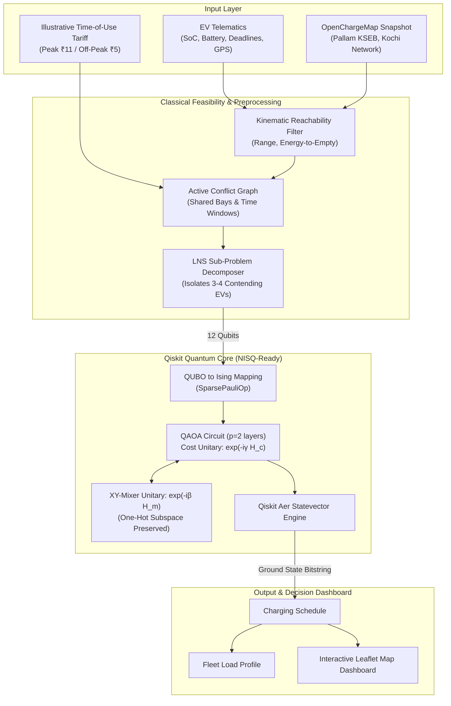

# Quantum.ev — Hybrid Quantum-Classical EV Fleet Charging Optimizer ⚡🚗

[](https://qiskit.org/)
[](https://github.com/Qiskit/qiskit-aer)
[](https://openchargemap.org)
[](LICENSE)
[](https://python.org)

> **Quantum Optimization for EV Charging Stations**  
> A live charging dispatcher for EV fleets, plus a Qiskit QAOA research track with an XY-mixer. Uses a snapshot of **OpenChargeMap** stations in Kerala, India. Results are simulated with a synthetic fleet.

---

## 📑 Table of Contents
1. [The Problem & Unique Value Proposition](#-the-problem--unique-value-proposition)
2. [Why Quantum? QAOA + XY-Mixer Innovation](#-why-quantum-qaoa--xy-mixer-innovation)
3. [System Architecture & Hybrid Workflow](#-system-architecture--hybrid-workflow)
4. [Real-World Kerala EV Infrastructure (OpenChargeMap)](#-real-world-kerala-ev-infrastructure)
5. [Benchmark Results & Performance Metrics](#-benchmark-results--performance-metrics)
6. [Quick Start & Reproducibility](#-quick-start--reproducibility)
7. [Hackathon Evaluation Mapping (01–06)](#-hackathon-evaluation-mapping)

---

## ⚡ The Problem & Unique Value Proposition

### The Problem
When several EVs share one charging network in the same evening, bays sit empty while cars drive to them, drivers queue, and fleets pay for avoidable waiting and peak-rate energy. Requests also arrive one at a time, so a plan made once at the start of a shift goes out of date quickly.

### The Quantum.ev Solution
Quantum.ev books each bay from the car's arrival time and re-plans every car that has not left whenever a new request comes in. Cars on the road keep their booking.

Mean of 10 simulated evenings (9 chargers, synthetic fleet, illustrative tariff):

| Cars | Lock bay on departure | Book by arrival (nearest) | **Book by arrival + re-plan** | Perfect hindsight |
| :--- | ---: | ---: | ---: | ---: |
| 30 | ₹7,765 | ₹7,205 | **₹6,686** | ₹6,607 |
| 50 | ₹16,422 (7.8 unserved) | ₹12,886 | **₹11,775** | ₹11,441 |
| 80 | ₹33,838 (33.3 unserved) | ₹25,520 (10.2 unserved) | **₹22,333 (2.7 unserved)** | ₹21,311 (2.3 unserved) |

Regenerate with `python run_experiments.py live`. See the demo at `/live`.

---

## ⚛ Why Quantum? QAOA + XY-Mixer Innovation

### 1. Status of the Quantum Component
QAOA is a research track, not the production engine. The problem is NP-hard in general, but at the sizes tested the classical HiGHS solver proves the optimum in about 2 seconds or less, up to 200 cars. In the 12 fleet benchmarks QAOA took 37-81 s and tied the brute-force sub-solver in 10 runs, so it shows no quantum advantage here. The contribution is the formulation: the XY-mixer returns valid assignments far more often than the standard mixer, as shown below.

### 2. QUBO & Ising Hamiltonian Formulation
We represent the decision problem as a Quadratic Unconstrained Binary Optimization (QUBO) model where binary variable $x_i \in \{0, 1\}$ represents whether an EV takes a specific charging option (station $c$, start slot $s$, duration $d$):

$$H_C = \sum_{i} c_i \frac{I - Z_i}{2} + A \sum_{(i,j) \in \text{conflicts}} \left(\frac{I - Z_i}{2}\right)\left(\frac{I - Z_j}{2}\right)$$

Where:
- $c_i$: Unified Rupee cost = Energy Cost (₹) + Driver Wait Time (₹) + Driving Distance (₹).
- $\text{conflicts}$: Set of option pairs $(i,j)$ that clash on the same physical charger bay at the same time slot.
- $A$: Penalty multiplier ensuring conflict-free scheduling.

### 3. The XY-Mixer (Particle-Hopping Constraint Preservation)
Standard QAOA uses a transverse-field mixer $H_M = \sum_i X_i$, which flips qubits independently. In EV scheduling, each vehicle has a register of options and must choose **exactly one** option ($\sum_{i \in \text{ev}} x_i = 1$). 

In our 12-qubit benchmark, standard QAOA returned a valid assignment for only 10-25% of shots.

**Quantum.ev solves this using an XY-Mixer**:
$$H_M = \frac{1}{2} \sum_{(i,j) \in \text{register}} (X_i X_j + Y_i Y_j) = \sum_{(i,j)} (\sigma_i^+ \sigma_j^- + \sigma_i^- \sigma_j^+)$$

```
Standard Mixer (X):    |0010⟩  ──[X]──>  |0110⟩   ❌ Invalid (Car booked twice!)
XY-Mixer (X_i X_j + Y_i Y_j): |0010⟩  ──[XY]──> |0100⟩   ✅ Valid (One-hot subspace preserved!)
```

**Key Advantages:**
1. **Zero Slack Qubits:** No ancillary qubits needed to enforce the one-hot constraint.
2. **Exponentially Smaller Search Space:** Constrained strictly to valid schedule combinations ($\prod k_i$ rather than $2^{\sum k_i}$).
3. **Higher validity:** 69-80% valid at 12 qubits, against 10-25% for the standard mixer. The one-hot rule always holds in ideal simulation, but bay conflicts remain soft penalties. Validity falls to 51-79% at 8 qubits in a simulated noise model of IBM Torino.

### 4. Hybrid LNS (Large Neighborhood Search) Decomposition
To keep each circuit small enough for near-term devices:
- **Classical Decomposition:** Identifies high-regret, tightly contending sub-groups of 3–4 EVs that share charging bottlenecks.
- **Quantum Execution:** Submits these sub-problems (12 qubits) to QAOA on Qiskit Aer.
- **Iterative Improvement:** Integrates quantum improvements back into the master schedule in real time.

---

## 🔬 System Architecture & Hybrid Workflow



---

## 📍 Real-World Kerala EV Infrastructure

Quantum.ev includes a saved snapshot of OpenChargeMap (OCM) station records across the Kottayam–Kochi transport corridor in Kerala, India:

| Station Name | Operator | Location | Fast Chargers | Listed Tariff |
| :--- | :--- | :--- | :--- | :--- |
| **Pallam KSEB EVCS** (OCM-313584) | ChargeMOD / KSEB | Pallam, Kottayam | 1× 30 kW CCS, 1× 30 kW CHAdeMO, 1× 15 kW GB-T | ₹27.41/kWh |
| **Nucleus Mall EVCS** (OCM-480424) | GO EC | Maradu, Kochi | 2× 90 kW CCS, 2× 80 kW CCS | ₹22.48/kWh |
| **Crowne Plaza Kochi EVCS** (OCM-480423) | Statiq / GO EC | Kundannoor, Kochi | 2× 60 kW CCS | ₹24.00/kWh |
| **The Windsor Castle EVCS** (OCM-313437) | ChargeMOD | MC Road, Kottayam | 2× 60 kW CCS | ₹25.00/kWh |
| **Manipuzha Lazza EVCS** (OCM-480417) | ChargeMOD | Kodimatha, Kottayam | 1× 30 kW CCS, 2× 7.4 kW Type 2 | ₹22.00/kWh |
| **Indraprastha Hotel EVOK** (OCM-313586) | ChargeMOD | Kumaranellor, Kottayam| 2× 50 kW CCS | ₹23.50/kWh |

---

> The optimizer does not yet use these listed tariffs. Costs come from the illustrative time-of-use tariff in `evcharge/instance.py`.

## 📊 Benchmark Results & Performance Metrics

Batch planning with all cars known in advance. 12 runs: 10, 20, 30 and 50 cars, 3 seeds each (`results/fleet.json`).

| Metric | Nearest station | QAOA hybrid | Exact MILP (HiGHS) |
| :--- | ---: | ---: | ---: |
| Cost saved vs nearest | baseline | 0-10.1% | 0-12.2% |
| Gap to proven optimum | n/a | 0-5.1% | 0% |
| Solve time at 50 cars | instant | 41-81 s | under 0.2 s |
| Qubits per sub-problem | n/a | 12 (simulated) | n/a |

Peak load is not part of the objective, so optimised plans do not reduce it: peak kW stayed the same or rose compared with nearest-station in all 12 runs.

All costs use a synthetic fleet and an illustrative tariff. No result here comes from real quantum hardware or field trials.

---

## 🚀 Quick Start & Reproducibility

### 1. Prerequisites
- Python 3.10, 3.11, 3.12, or 3.13
- Git

### 2. Installation
```bash
# Clone the repository
git clone https://github.com/Khaisekabeer/QuantumXDroid.git
cd QuantumXDroid

# Create and activate virtual environment
python -m venv venv

# Windows:
.\venv\Scripts\activate
# Linux/macOS:
source venv/bin/activate

# Install required dependencies
pip install -r requirements-dev.txt
```

### 3. Launch Interactive Web Dashboard
```bash
python app.py
```
Open **`http://localhost:5000`** in your browser.
- **Select Fleet Presets:** Click *E-Commerce Delivery Fleet*, *Kochi Electric Cabs*, or *Highway Commuters*.
- **Interactive Pin-Drop:** Click anywhere on the Kerala map to place custom EVs with custom battery SoC.
- **Run QAOA:** Click **Run Quantum QAOA Optimization** to run the simulated QAOA loop (about a minute) and compare it with the baseline and the exact optimum.

The live dispatch demo is at **`http://localhost:5000/live`**.

### 4. Run on Localhost with Waitress (Optional)
`python app.py` is enough for a demo. For a steadier local server, use Waitress with the virtual environment active:
```bash
waitress-serve --host=127.0.0.1 --port=5000 --threads=8 app:app
```
Then open **`http://localhost:5000`** for the fleet map, **`http://localhost:5000/live`** for live dispatch, or `http://localhost:5000/healthz` for a status check. Press `Ctrl+C` in the terminal to stop the server.

To use a different port, set `PORT` before `python app.py`, or change `--port` for Waitress.

`POST /api/optimize` uses the exact solver by default. Pass `"engine": "qaoa"` for the research path, limited by `QAOA_CONCURRENCY` (default 1).

### 5. Run CLI Demo & Unit Tests
```bash
# Run standalone CLI optimization demo (15 cars)
python demo.py 15 42 --ocm

# Run full automated test suite
pytest tests/ -v

# Regenerate the dispatch benchmark, or the quantum benchmarks
python run_experiments.py live
python run_experiments.py sub
```

---

## 📋 Hackathon Evaluation Mapping

| Section | Criterion | Where Addressed in Quantum.ev |
| :--- | :--- | :--- |
| **01. Project Info** | Team, challenge, roles | Challenge: *Quantum Optimization for EV Charging Stations*. [README.md](README.md) & [app.py](app.py). |
| **02. Problem Statement** | Real-world problem, impact, affected users (150–300 words) | Section 1 of README: Commercial fleet ToU tariff arbitrage, transformer overload, and driver downtime. |
| **03. Proposed Solution** | Workflow, Input → Processing → Output, architecture | Section 3 Mermaid diagram: Telematics + OCM $\to$ Kinematic filter $\to$ QUBO/Ising $\to$ QAOA $\to$ Route & schedule dispatch. |
| **04. Quantum Component** | Meaningful quantum usage, algorithm, mapping | Section 2: QAOA with XY-mixer preserving one-hot subspace, Ising mapping via `SparsePauliOp`, LNS decomposition. |
| **05. Reproducibility** | Complete working code, README, datasets | Full instructions above: `python app.py`, `python demo.py`, `pytest tests/`, OpenChargeMap dataset in `evcharge/data/`. |
| **06. Qiskit Usage** | Libraries, circuits, algorithms, backends | Section 2 & 3: `qiskit` 2.6.1, `qiskit-aer` 0.18.2, `AerSimulator`, parameterized Pauli-Z and XY circuits. |

---

## 👥 Contributors & Acknowledgements
- Built for the **Qiskit Hackathon / Hack Day**
- Station records from [OpenChargeMap](https://openchargemap.org). Check its current licence and attribution terms before commercial use.
- Developed with [Qiskit](https://qiskit.org) and Python.
